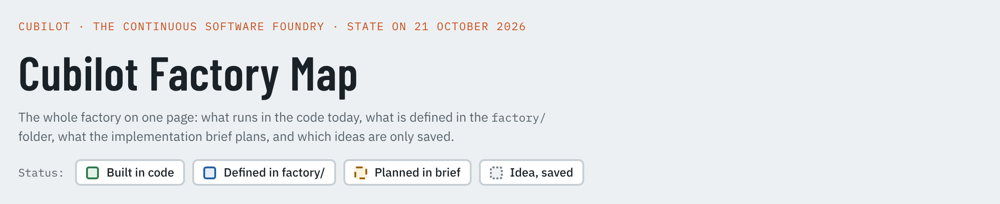
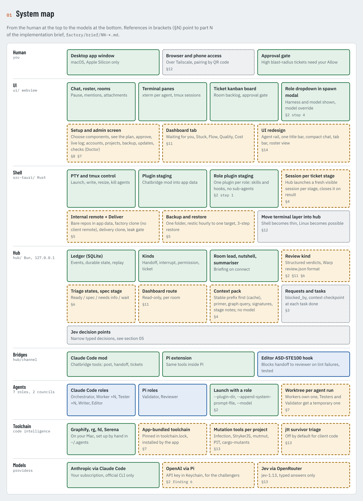
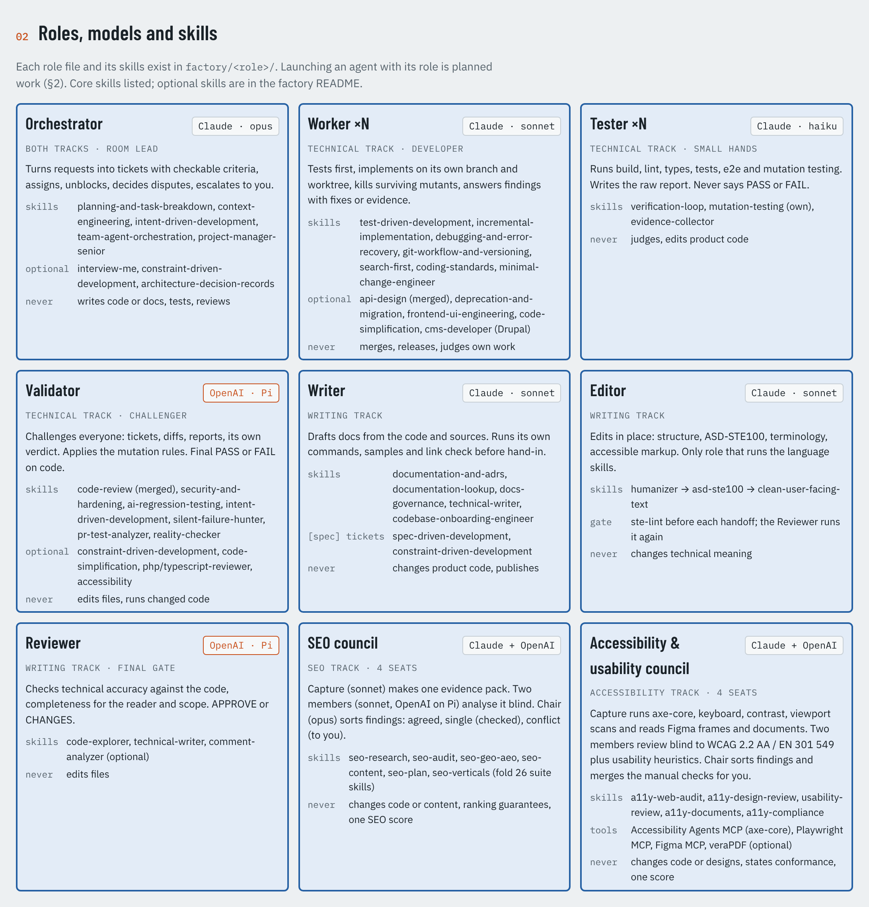
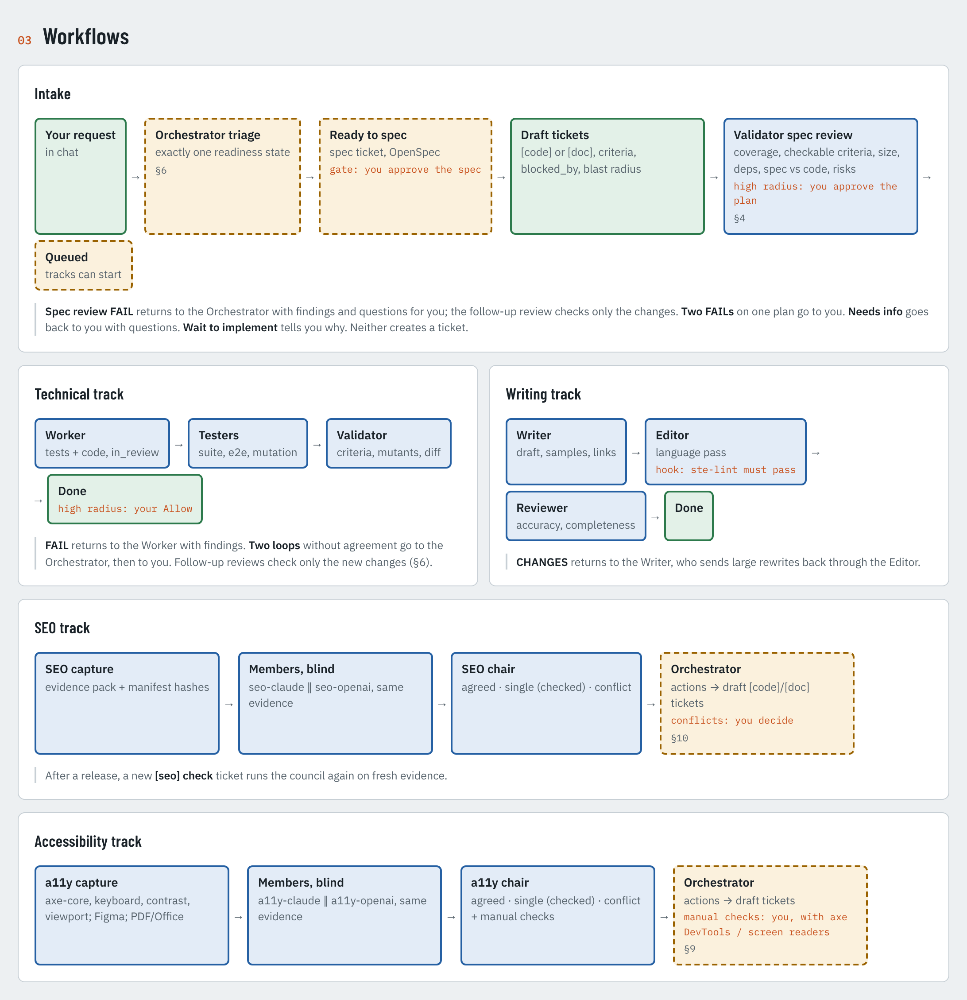
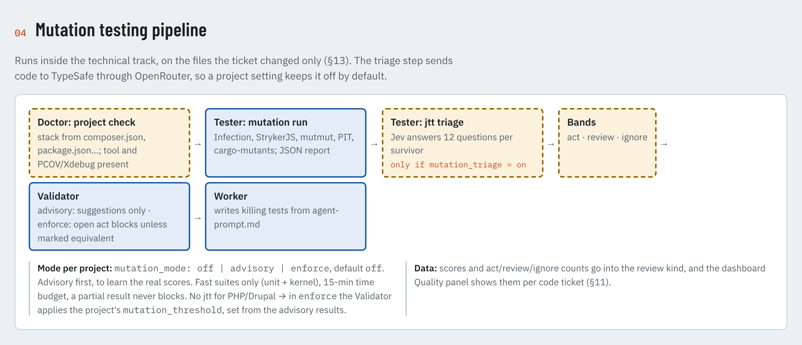
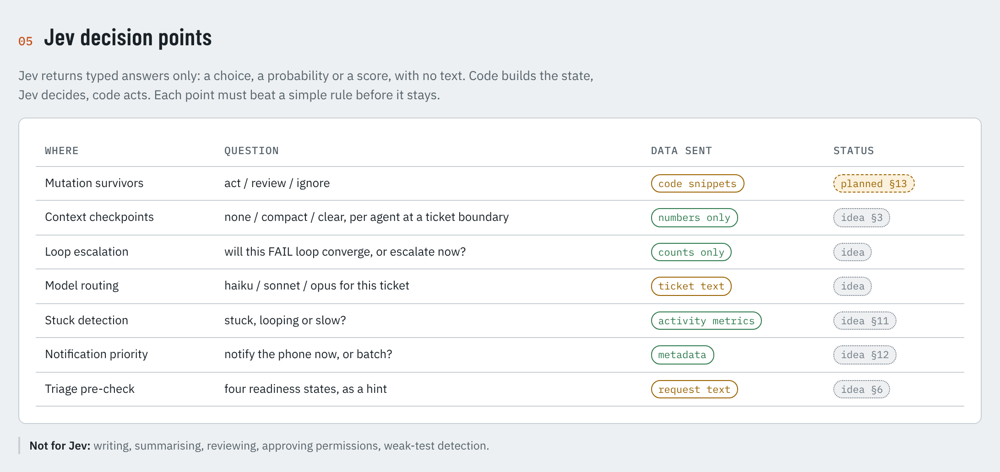
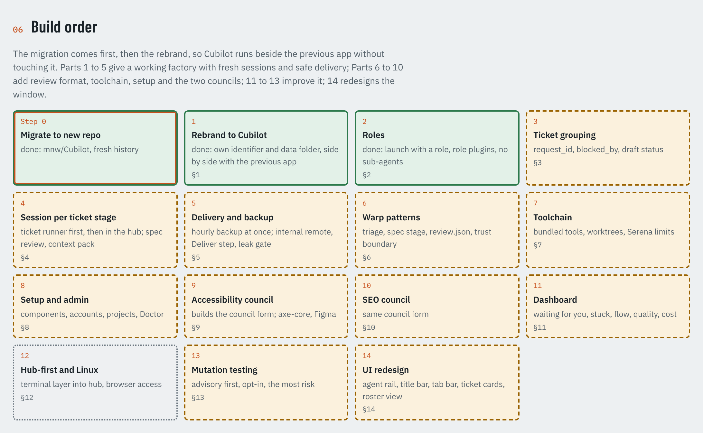

<h1 align="center">Cubilot</h1>
<p align="center"><b>The Continuous Software Foundry</b><br>
AI agent teams that build software through tickets, reviews and human approval.</p>

Cubilot is a macOS desktop app. It runs a team of coding agents (Claude Code, and OpenAI through Pi) in visible terminal sessions, connected through a local hub. The agents work from tickets, other agents check the work, and you approve the plans and the risky changes.

<p align="center">
<a href="docs/factory-map.html">Interactive map</a> (download, open in a browser) ·
<a href="docs/GUIDE.md">User guide</a> ·
<a href="docs/PROTOCOL.md">Protocol</a> ·
<a href="factory/brief/00-index.md">Implementation brief</a> ·
<a href="factory/">Factory roles</a>
</p>

<picture>
  <source media="(prefers-color-scheme: dark)" srcset="docs/readme/00-header-dark.png">
  
</picture>


<picture>
  <source media="(prefers-color-scheme: dark)" srcset="docs/readme/01-system-map-dark.png">
  
</picture>

<picture>
  <source media="(prefers-color-scheme: dark)" srcset="docs/readme/02-roles-dark.png">
  
</picture>

<picture>
  <source media="(prefers-color-scheme: dark)" srcset="docs/readme/03-workflows-dark.png">
  
</picture>

<picture>
  <source media="(prefers-color-scheme: dark)" srcset="docs/readme/04-mutation-testing-dark.png">
  
</picture>

<picture>
  <source media="(prefers-color-scheme: dark)" srcset="docs/readme/05-jev-dark.png">
  
</picture>

<picture>
  <source media="(prefers-color-scheme: dark)" srcset="docs/readme/06-build-order-dark.png">
  
</picture>

## Build from source

Requires macOS on Apple Silicon, Bun, Rust and the Claude Code CLI. Pi is needed for the OpenAI roles. See the [user guide](docs/GUIDE.md) for the full steps.

```bash
bun install
bun test
scripts/build-tmux.sh && scripts/build-sidecars.sh
bun run tauri:build
```

## About the images

The images above are screenshots of [`docs/factory-map.html`](docs/factory-map.html), in a light and a dark version. To update them after a change to the map, see [`docs/readme/README.md`](docs/readme/README.md).

## Licence

See [`LICENSE`](LICENSE). Third-party skills and suites keep their own licences, listed in [`factory/licenses/`](factory/licenses/).
