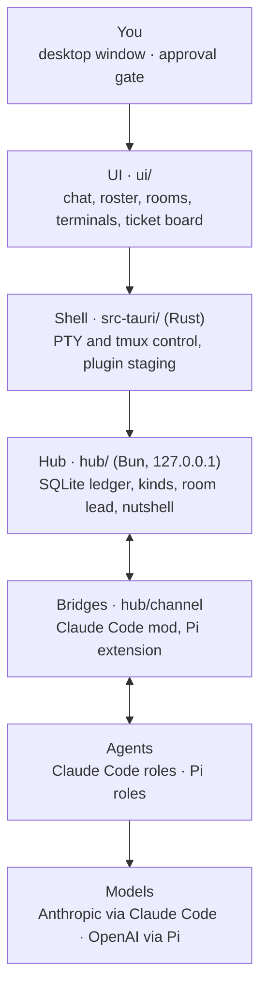
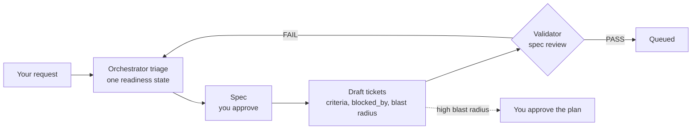
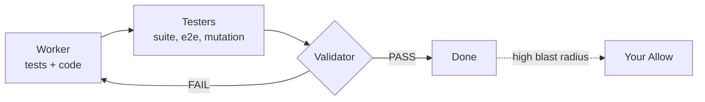
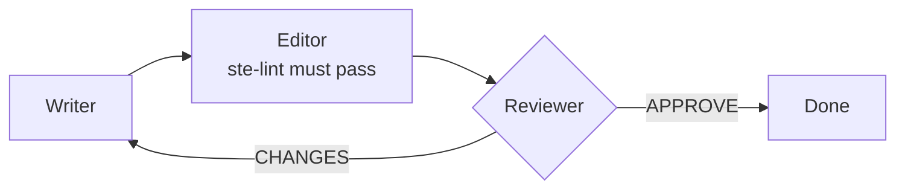
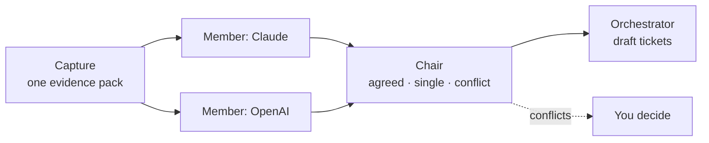

# Cubilot

**The Continuous Software Foundry.** AI agent teams that build software through tickets, reviews and human approval.

Cubilot is a macOS desktop app. It runs a team of coding agents (Claude Code and OpenAI through Pi) in visible terminal sessions, connected through a local hub. The agents work from tickets. Other agents check the work. You approve the plans and the risky changes.

> **Status.** Cubilot is in active development. The core (rooms, agents, tickets, handoffs, the ledger) runs today. The factory roles are defined in [`factory/`](factory/). The rest is planned in the [implementation brief](factory/brief/00-index.md).
>
> Status labels in this file: **built** (runs in code), **defined** (in `factory/`), **planned** (in the brief), **idea** (saved, not planned).

- User guide (install, rooms, tools, config, troubleshooting): [`docs/GUIDE.md`](docs/GUIDE.md)
- Visual factory map (open in a browser): [`docs/factory-map.html`](docs/factory-map.html)
- Protocol: [`docs/PROTOCOL.md`](docs/PROTOCOL.md)

## System map



| Layer | Built | Planned |
|---|---|---|
| UI | Chat, roster, rooms, pause, attachments · terminal pane per agent · ticket board | Role choice in the spawn dialog (§2) · setup and admin screen (§8) · dashboard (§11) · browser and phone access (§12) |
| Shell | PTY and tmux control · chatbridge mod staging | Role plugin staging (§2) · one session per ticket stage (§4) · internal remote, delivery and backups (§5) · terminal layer moves into the hub (§12) |
| Hub | SQLite ledger with replay · kinds: handoff, interrupt, permission, ticket · room lead, nutshell, summariser | Review kind (§2, §6, §11) · triage and spec stage (§6) · context pack (§4) · requests and tasks with `blocked_by` (§3) |
| Bridges | Claude Code mod and Pi extension with the chatbridge tools | — |
| Toolchain | Graphify, ripgrep, fd, Serena, set up by hand | Bundled and pinned by the app (§7) · mutation tools per project (§13) |

§N refers to part N of the brief: `factory/brief/NN-*.md`.

## The team

Every role is a separate, visible session. No role uses sub-agents. Role files and skills are in `factory/<role>/` (**defined**). Launching an agent with its role is planned in §2.

| Role | Model | Track | Does | Never |
|---|---|---|---|---|
| Orchestrator | Claude opus | All · room lead | Turns requests into tickets with checkable criteria, assigns, unblocks, escalates to you | Writes code or docs, tests, reviews |
| Worker ×N | Claude sonnet | Technical | Writes tests first, then code, on its own `ticket/<id>` branch and worktree | Merges, releases, judges its own work |
| Tester ×N | Claude haiku | Technical | Runs build, lint, types, tests, e2e, mutation runs · writes the raw report | Says PASS or FAIL, edits product code |
| Validator | OpenAI on Pi | Technical · challenger | Reviews the plan and specs, then the code · final PASS or FAIL | Edits files, runs changed code |
| Writer | Claude sonnet | Writing | Drafts docs and specs from the code and sources | Changes product code, publishes |
| Editor | Claude sonnet | Writing | Edits structure and language (ASD-STE100) · a lint hook gates the hand-in | Changes technical meaning |
| Reviewer | OpenAI on Pi | Writing · final gate | Checks accuracy, completeness and scope · APPROVE or CHANGES | Edits files |
| SEO council | Claude + OpenAI, 4 seats | SEO | Evidence pack, two blind reviews, a chair sorts the findings | Changes code or content, promises rankings |
| Accessibility council | Claude + OpenAI, 4 seats | Accessibility | axe-core, keyboard, contrast and Figma evidence · WCAG 2.2 AA and EN 301 549 review | Changes code or designs, claims conformance |

Claude and OpenAI models check each other's work: the builders are Claude, the challengers are OpenAI.

## How work flows

### Intake



Two FAILs on one plan go to you. "Needs info" comes back to you with questions.

### Technical track



### Writing track



### Councils (SEO and accessibility)



The two members do not see each other's findings.

## Ground rules

- Every agent is a visible session that you can watch and stop. No sub-agents.
- One fresh session for each ticket stage, with a small context pack instead of a full re-read.
- Agents never reach a client repository. Work goes to an internal remote. A separate Deliver step squashes it, runs a leak check and pushes only after you approve.
- One data folder holds the whole factory. An hourly encrypted backup covers it, and a restore takes three steps (§5).

## Build order

| Step | Part | What |
|---|---|---|
| 0 | Migration | New repo `mnw/Cubilot`, fresh history (**done**) |
| 1 | Rebrand | Own identifier and data folder, side by side with the previous app |
| 2 | Roles | Launch script first, then role launch in the app |
| 3 | Ticket grouping | Requests, `blocked_by`, `draft` status |
| 4 | Sessions | One session per ticket stage, spec review, context pack |
| 5 | Delivery and backup | Internal remote, Deliver step, leak check, hourly backup |
| 6 | Review patterns | Triage, spec stage, `review.json`, trust boundary |
| 7 | Toolchain | Bundled tools, worktrees, Serena limits |
| 8 | Setup and admin | Components, accounts, projects, Doctor |
| 9 | Accessibility council | Builds the council form · axe-core, Figma |
| 10 | SEO council | Same council form |
| 11 | Dashboard | Waiting for you, stuck, flow, quality, cost |
| 12 | Hub-first and Linux | Terminal layer into the hub, browser access |
| 13 | Mutation testing | Advisory first, opt-in for each project |

Derived work, as OpenSpec changes and agent briefs: [`factory/work/`](factory/work/).

## Repository layout

| Folder | Contents |
|---|---|
| `hub/` | Bun hub: ledger, kinds, routes · `hub/channel/` holds the bridges |
| `ui/` | Webview UI |
| `src-tauri/` | Rust shell: window, PTY, tmux, staging |
| `tests/` | Unit and integration tests (`bun test`) |
| `openspec/` | Specs and changes (OpenSpec 1.14.3) |
| `docs/` | User guide, protocol, architecture, ADRs, reviews |
| `factory/` | Roles, skills, councils, the implementation brief, derived work |
| `scripts/` | Build, install and release scripts |

## Build from source

See [`docs/GUIDE.md`](docs/GUIDE.md) for the full steps. In short:

```bash
bun install
bun test
scripts/build-tmux.sh && scripts/build-sidecars.sh
bun run tauri:build
```

Requires macOS on Apple Silicon, Bun, Rust and the Claude Code CLI. Pi is needed for the OpenAI roles.

## Licence

See [`LICENSE`](LICENSE). Third-party skills and suites keep their own licences, listed in [`factory/licenses/`](factory/licenses/).
